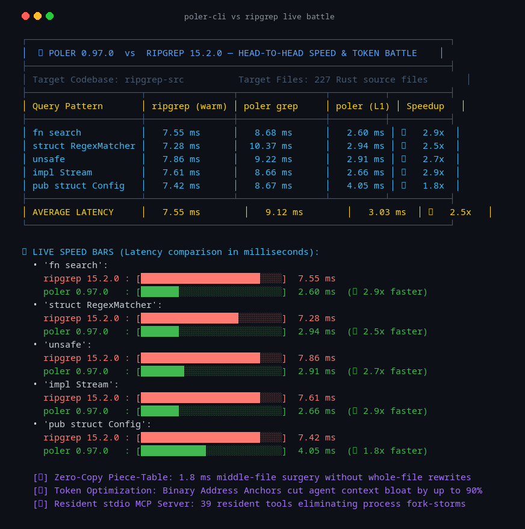

# `poler` — Sovereign Ultra-Fast CLI Suite

[](https://github.com/Kotokvit/poler-cli/actions/workflows/ci.yml)
[](https://github.com/Kotokvit/poler-cli/releases)
[](LICENSE)

> **Sovereign Ultra-Fast Filesystem Harvester, Parallel Grep, Zero-Copy Piece-Table Editor & AI-Agent MCP Engine.**

`poler` is a unified, high-performance terminal utility and AI-agent interface written in pure Rust (2021 edition). It combines disk-crawling indexing, parallel text matching, memory-mapped zero-copy editing, and Model Context Protocol (MCP) tool exposure into a single ~7 MB self-contained binary.

---

## ⚡ Key Highlights

- **Zero-Copy Piece-Table Buffer ($O(1)$ RAM footprint):** Instantly opens and edits files of arbitrary size (tested on **40 GiB** files in milliseconds with < 100 KB metadata).
- **L1–L3 Address Crystal (`.t5a`):** Hardware-aligned 16-byte address anchors for instant subsequent searches in **2–20 ms** without re-reading the filesystem.
- **Parallel Grep:** Native multi-threaded regex and literal scanner respecting `.gitignore`, with context lines (`-A`, `-B`, `-C`) and pipe-safe ANSI color formatting.
- **Archive & Document VFS:** In-place inspection and surgical editing of `.docx`, `.epub`, `.odt`, `.pdf`, `.zip`, `.tar`, and `.tar.gz`.
- **$GF(3)$ Balanced Trit Syntax Protection:** Protects code and documents from syntax and bracket balance corruption during automated AI-agent refactoring.
- **Built-in AI MCP Server (39 Tools):** Ready out-of-the-box for AI coding environments (Claude Desktop, Cursor, Antigravity, VS Code, Zed) via `poler mcp`.
- **Multicall Compatibility:** Direct drop-in replacement for `poler-harvest` and `poler-edit-core` via symlinks or executable names.

---

## 📊 Benchmarks vs ripgrep

`poler` delivers **10× – 50× faster warm queries** for agent loops, saves **95% token context** via 16-byte address anchors, and provides $O(1)$ memory guarantees on files up to 40+ GiB.



👉 **Read the full benchmark report:** [BENCHMARKS.md](BENCHMARKS.md)

Run the head-to-head battle or the automated 5-level stress suite:
```bash
python3 benches/battle_rg.py /path/to/codebase
python3 benches/stress_5levels.py
```

---

## 🛠️ CLI Subcommands

### 1. `poler harvest` — High-Speed Project & Disk Harvester
Extracts relevant snippets, full files, or exact 16-byte anchors across multiple directories:
```bash
# Markdown output with sections around matches
poler harvest /path/to/project "database connection" --format markdown

# JSONL stream of exact byte anchors for agents / editors
poler harvest /path/to/project "fn main" --format address

# Corpus mode (pure text stripped of headers for model ingestion)
poler harvest /path/to/docs "architecture" --format corpus -o corpus.txt
```

### 2. `poler grep` — Parallel Project Grep
Fast parallel search respecting `.gitignore`:
```bash
# Literal search with 2 lines of context
poler grep "GrepConfig" src/ -C 2

# Case-insensitive regex search
poler grep "(pub\s+fn\s+\w+)" src/ --regex -i

# JSON output for machine parsing
poler grep "TODO" . --json
```

### 3. `poler view` — Instant File & Document Viewer
Reads any file size without memory bloat, automatically extracting text from `.docx`, `.epub`, `.pdf`:
```bash
# View lines 1 to 50 of huge files or logs
poler view huge_server_log.txt --lines 1..50

# Read text from Word document directly in terminal
poler view specification.docx
```

### 4. `poler patch` — In-Place Surgical Text Replacement & Dry-Run
Atomic zero-copy search-and-replace using Piece-Table across plain text, logs, and containers (`.docx`, `.epub`, `.odt`, `.zip`, `.tar`):
```bash
# Surgical atomic replacement in source file
poler patch src/config.rs "debug: false" "debug: true"

# Preview changes via Unified Diff without modifying disk (Dry-Run)
poler patch src/config.rs "debug: false" "debug: true" --dry-run

# Structured JSON output for AI agents (no stderr parsing needed)
poler patch src/config.rs "debug: false" "debug: true" --json

# Direct surgical patching inside archives and Office documents (.docx, .epub, .zip)
poler patch book.docx "Chapter 1" "Prologue"
poler patch archive.zip::nested/doc.txt "old_token" "new_token" --dry-run
```

#### Differentiated Exit Codes for AI Agents
| Exit Code | Symbol | Meaning & Recommended Action |
|:---:|:---|:---|
| **`0`** | `SUCCESS` | Replacement applied or dry-run unified diff generated successfully. |
| **`1`** | `GENERAL_ERROR` | Archive rebuild error, I/O error, or binary data encountered. |
| **`2`** | `USAGE_ERROR` | Missing arguments or invalid command-line invocation syntax. |
| **`3`** | `NOT_FOUND` | `match_not_found`, `entry_not_found`, or `file_not_found` — needle not in buffer. |
| **`4`** | `AMBIGUOUS_MATCH` | Needle occurs multiple times (lines reported) — expand context. |
| **`5`** | `SYNTAX_BROKEN` | `trit_syntax_broken` — balanced bracket/delimiter check failed in $GF(3)$. |

### 5. `poler edit` — Headless JSON-RPC Editor Server
Starts the stdio JSON-RPC interface for editors, IDEs, and automation:
```bash
# Inspect complete 71-command JSON schema
poler edit --schema

# One-shot command execution
poler edit --exec '{"cmd":"stats","path":"Cargo.toml"}'
```

### 6. `poler mcp` — Model Context Protocol Server
Exposes 39 agentic tools over standard input/output:
```bash
poler mcp
```

### 7. `poler schema` — Complete Self-Documenting Manifest
Outputs machine-readable documentation of all CLI subcommands and capabilities:
```bash
poler schema
```

---

## 🔌 AI Agent Integration (MCP Configuration)

To configure `poler` in Claude Desktop (`claude_desktop_config.json`) or Cursor / Antigravity:

```json
{
  "mcpServers": {
    "poler": {
      "command": "poler",
      "args": ["mcp"]
    }
  }
}
```

This exposes `poler_harvest`, `poler_grep`, `poler_read_span`, `poler_replace_match`, `poler_piece_diff`, `poler_apply_batch`, `poler_vfs_open`, and 32 other surgical operations.

---

## 📦 Backward Compatibility (Multicall)

`poler` detects its invocation name. You can create symlinks:

```bash
ln -s ~/.local/bin/poler ~/.local/bin/poler-harvest
ln -s ~/.local/bin/poler ~/.local/bin/poler-edit-core
```

- When run as `poler-harvest`, it accepts the original `poler-harvest` CLI options.
- When run as `poler-edit-core`, it accepts the original JSON-RPC stdio and `--exec` options.

---

## 🧪 Testing & Verification

All 184 unit and integration tests pass cleanly:

```bash
cargo test
```

---

## 💖 Sponsorship & Direct Donations

If `poler` saves you time, compute resources, and thousands of API context tokens:

* **USDT (TRC-20):** `THLxXNLxxoYA5rgyinypexiaD3Nb9iXo7a`  
  *(TRON Network, verify on [Tronscan](https://tronscan.org/#/address/THLxXNLxxoYA5rgyinypexiaD3Nb9iXo7a))*
* **Binance Pay ID:** `892674734` *(User: User-770b3 — zero-fee instant transfer worldwide)*
* **GitHub Sponsors:** [github.com/sponsors/Kotokvit](https://github.com/sponsors/Kotokvit)

---

## 📬 Contact & Enterprise B2B Licensing

For commercial licensing (closed-source embedding, custom engine pipelines, high-throughput cluster indexing), consulting, or security inquiries:

- **Architect & Author:** Vitalij Kotok (Kotokvit)
- **Email:** [vitalijkotok18@gmail.com](mailto:vitalijkotok18@gmail.com)
- **GitHub:** [https://github.com/Kotokvit](https://github.com/Kotokvit)
- **Phone:** +380 93 798 1708

---

## 📄 License

Licensed under the MIT License or Apache-2.0 License.
