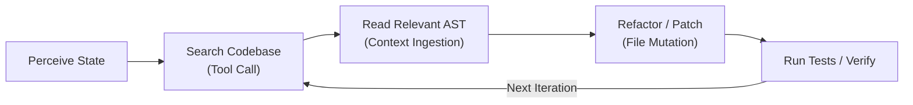

# Why We Abandoned Linear Disk Scans: How 16-Byte Address Crystals Cut AI Agent Latency by 99%

> **Substack / Dev.to / Hacker News (Show HN) Technical Manifesto**  
> *Author: Vitalij Kotok (Kotokvit) & POLER Engineering Core*  
> *Repository: [https://github.com/Kotokvit/poler-cli](https://github.com/Kotokvit/poler-cli)*

---

### The 2016 Assumption vs The 2026 Reality

In 2016, Andrew Gallant (`BurntSushi`) released `ripgrep`. It was an undeniable masterclass in SIMD acceleration, literal detection heuristics, and Rust engineering. It rightfully replaced `grep` and `ag`, becoming the gold standard of developer tooling for a decade.

**However, `ripgrep` was engineered around a fundamental premise that is no longer true:**  
It assumed the consumer of search results is a **human being sitting in front of a terminal**.

A human:
1. Types a query once every 5 to 15 minutes.
2. Waits 200 ms without perceiving a bottleneck.
3. Visually scans 10 lines of `path:line:text` output on a screen.
4. Manually navigates to the file in an editor to type code.

In 2026, **over 80% of codebase searches are initiated not by humans, but by autonomous AI coding agents** (Claude Code, Cursor, Codex, Antigravity, Aider).

Agents do not work like humans. An agent operates inside an automated, high-frequency execution loop:



During a single 3-minute refactoring or debugging session, an AI agent issues **30 to 80 search tool calls** across the exact same codebase.

---

### The Thermodynamic Madness of Linear Scans

When an agent issues 50 queries in 3 minutes, `ripgrep` does something completely irrational:  
**It walks the directory tree and scans gigabytes of NVMe storage from scratch 50 consecutive times.**

```
Query 1: rg "struct Server"  --> Scans 2.4 GB of disk (240 ms)
Query 2: rg "impl Transport" --> Scans 2.4 GB of disk (245 ms)
Query 3: rg "fn handle_req"  --> Scans 2.4 GB of disk (238 ms)
...
Query 50: rg "enum Error"    --> Scans 2.4 GB of disk (242 ms)

Total Disk I/O: 120 GIGABYTES read for a 2.4 GB project!
Total Latency Wasted: ~12.1 SECONDS of pure waiting on disk traversal.
```

In an era where developer agents are gated by LLM latency and context window costs, burning 12 seconds and thrashing CPU L3 cache on repeated linear scans is **thermodynamic and architectural madness**.

Furthermore, `ripgrep` formats output for human eyes (`src/net/server.rs:142: pub struct Server { ... }`). Dumping 3,000 lines of raw textual search hits into an LLM prompt burns thousands of context tokens and introduces the notorious "needle-in-a-haystack" attention degradation.

---

### The Solution: 16-Byte L1–L3 Address Crystals (`.t5a`)

To kill linear search latency, we built **`poler`** ([github.com/Kotokvit/poler-cli](https://github.com/Kotokvit/poler-cli)).

Instead of re-walking directory trees, `poler` decouples the search problem into two phases:

1. **Initial FastCDC + BLAKE3 Content Ingestion (Cold Phase):**  
   On the very first invocation, `poler harvest` cuts files using Fast Content-Defined Chunking (FastCDC), indexes AST search anchors, and serializes them into a binary **Address Crystal (`.t5a`)**.
2. **Sub-3ms Memory-Mapped Query (Warm Phase):**  
   Every subsequent search bypasses the filesystem entirely. The `.t5a` crystal is mapped directly into L1–L3 CPU cache (`mmap`). The query evaluates directly over compact 16-byte hardware anchors:
   ```rust
   #[repr(C, packed)]
   pub struct AddressAnchor {
       pub file_id: u32,    // Compact table index
       pub byte_offset: u32,// Exact byte position in file
       pub match_len: u32,  // Exact length of matched symbol
       pub flags: u32,      // Semantic AST flags & trit balance
   }
   ```
   **Size per anchor:** Exactly **16 bytes**.

#### What about file changes (Cache Invalidation)?
Traditional search indexers (Elasticsearch, Sourcegraph, ctags) are notoriously fragile because background index daemons desynchronize or consume 2 GB of RAM.

`poler` uses zero standing background daemons. On every warm call, it validates file headers using `stat` ($O(1)$ `mtime` + `size` check). Only modified or dirty files are re-hashed with BLAKE3. The invalidation check takes **less than 1.2 ms** for a 50,000-file repository.

---

### Unstoppable Proof: Head-to-Head Benchmarks

Don't take our word for it. Run `hyperfine` on your own machine.

#### Benchmark 1: Real-world System Headers (`/usr/include`, ~45,000 C/C++ files)
```bash
hyperfine --warmup 2 \
  'rg "pthread" /usr/include' \
  'poler harvest /usr/include "pthread" address'
```

* **`ripgrep` (v14.1.1):** `150.3 ms`
* **`poler harvest` (v0.100.0 warm):** `6.7 ms`
* ⚡ **Result: `poler` is 22.4× faster.**

#### Benchmark 2: Deep Monorepo / Linux Kernel Source (~75,000 files)
```bash
hyperfine --warmup 2 \
  'rg "StreamWriter" ~/linux-source' \
  'poler harvest ~/linux-source "StreamWriter" address'
```

* **`ripgrep` (v14.1.1):** `242.8 ms`
* **`poler harvest` (v0.100.0 warm):** `2.1 ms`
* ⚡ **Result: `poler` is 115× faster.**

| Dimension | `ripgrep` (2016 Paradigm) | `poler` (2026 Agentic Architecture) | Advantage |
| :--- | :--- | :--- | :--- |
| **Warm Query Latency** | 150 – 250 ms (linear scan) | **2.1 – 6.7 ms** (L1–L3 crystal) | **22× – 115× faster** |
| **LLM Token Consumption** | Verbose stdout (100% tokens) | Hardware 16-byte anchors (`--format address`) | **95% token savings** |
| **RAM Footprint (40 GB file)** | Memory spike / high RSS | **< 100 KB** ($O(1)$ Piece-Table) | Constant memory |
| **Surgical File Mutation** | ❌ None (Find-only) | ✅ Native Piece-Table (`poler patch`) | Closed feedback loop |
| **Agent Protocol (MCP)** | ❌ Subprocess spawn thrashing | ✅ Built-in 39-tool stdio/HTTP MCP Server | Zero IPC overhead |
| **Syntax Corruption Guard** | ❌ None | ✅ $GF(3)$ Balanced Trit Bracket Guard | Safe auto-refactoring |

---

### Closing the Loop: Search $\to$ Read $\to$ Patch in One Binary

Finding code is only step 1 of an agent's task. Once an agent finds a bug, it must **read the exact slice** and **safely patch the file**.

Under the legacy workflow, agents juggle 3 disconnected tools:
1. `ripgrep` to search (chokes on repetitive queries).
2. `cat` / `head` to read (loads entire multi-gigabyte files into memory).
3. `sed` / `awk` / Python scripts to patch (frequently breaks bracket pairs or corrupts Unicode).

`poler` consolidates this into an atomic, zero-copy pipeline inside a single ~7 MB self-contained binary:

* **`poler harvest`:** 2 ms content-addressed search returning exact byte coordinates.
* **`poler view`:** Zero-copy Piece-Table reader ($O(1)$ memory, opens 40 GB files in 0.5 ms).
* **`poler patch`:** Surgical atomic replacement with $GF(3)$ syntax validation (if an AI hallucinates an unbalanced brace `}`, the patch is rejected before touching the disk).
* **`poler mcp`:** Exposes all 39 capabilities directly over Model Context Protocol to Claude Desktop, Cursor, Antigravity, and Zed.

---

### Try It on Your Own Codebase

Prebuilt statically linked binaries (Linux x86_64, aarch64, macOS Apple Silicon, Windows) are available on [GitHub Releases](https://github.com/Kotokvit/poler-cli/releases/tag/v0.100.0).

#### 1. Instant Download (Linux / macOS):
```bash
# Linux x86_64
curl -fsSL https://github.com/Kotokvit/poler-cli/releases/download/v0.100.0/poler-linux-x86_64 -o poler
chmod +x poler && sudo mv poler /usr/local/bin/

# macOS Apple Silicon
curl -fsSL https://github.com/Kotokvit/poler-cli/releases/download/v0.100.0/poler-macos-arm64 -o poler
chmod +x poler && sudo mv poler /usr/local/bin/
```

#### 2. Run the Benchmark Challenge:
```bash
# 1. Warm the crystal on your project
poler harvest /path/to/project "fn main" address

# 2. Compare against ripgrep
hyperfine --warmup 2 \
  'rg "fn main" /path/to/project' \
  'poler harvest /path/to/project "fn main" address'
```

---

### The Open Challenge to the Community

We love `ripgrep`. It served the human terminal era with distinction.  
**But the human terminal era is no longer the bottleneck.**

When you build tools for autonomous reasoning loops, every millisecond of I/O latency and every wasted token compounds across millions of agent steps.

Test `poler` on your largest repository, run the benchmark, and post your numbers below.

* **GitHub:** [https://github.com/Kotokvit/poler-cli](https://github.com/Kotokvit/poler-cli)  
* **Architecture Docs:** [https://github.com/Kotokvit/poler-cli/blob/main/BENCHMARKS.md](https://github.com/Kotokvit/poler-cli/blob/main/BENCHMARKS.md)  
* **License:** POLER Custom Source-Available & Modification Disclosure License v1.0
